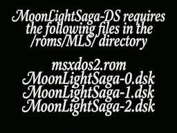
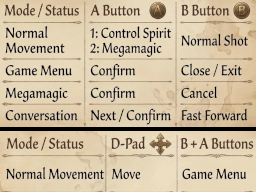

# MoonLightSaga-DS - MSX Turbo-R Emulator for the DSi/XL/LL

Moon Light Saga was released in 1997 as an MSX Turbo-R exclusive game. In 2020, the game's developer Ealia agreed on the free download of this game. Shortly thereafter, an English translation was completed.

Requires a DSi/XL/LL and will NOT run in DS-Lite or 'Compatibility' mode. The game
will check to make sure you have the needed processing power and RAM to run the game.

# Donations Welcome (but never required!)

These hobby emulators have been a labor of love. An embarassing amount of development time has gone into it as I've strived to provide an enjoyable retro experience on the DS handheld. It's free to use and always will be, however if you feel inclined to buy me a virtual coffee for the effort, that would be beyond amazing!

Brief Instructions :
-----------------------

Besides MoonLightSaga-DS.nds, there are exactly 4 files that must be supplied by the user and placed into the /roms/MLS directory:

The file names must be exactly as shown above. The MSXDOS2.rom is 64K in size.

And while playing the game:

Copyright :
-----------------------
MoonLightSaga-DS is Copyright (c) 2026 Dave Bernazzani (wavemotion-dave)

As long as there is no commercial use (i.e. no profit is made),
copying and distribution of this emulator, it's source code
and associated readme files, with or without modification, 
are permitted in any medium without royalty provided this 
copyright notice is used and wavemotion-dave (MoonLightSaga-DS),
and Marat Fayzullin (fMSX core) are thanked profusely.

The sound driver (ay38910) are libraries from FluBBa (Fredrik Ahlström) 
and those copyrights remain his.

lzav compression (for save states) is Copyright (c) 2023-2025 Aleksey 
Vaneev and used by permission of the generous MIT license.

The MoonLightSaga-DS emulator is offered as-is, without any warranty.

<a href="https://www.flaticon.com/free-icons/save" title="save icons">Save icons created by srip - Flaticon</a>

Saving Progress :
-----------------------
MoonLightSaga-DS provides FM-PAC to save games. Do not use disk storage - it's not persisted back to the SD.

Version History :
-----------------------
Version 1.1 - 16-Nov-2026 by wavemotion-dave
* Improved sound sampling (from improvements done on Vroom-DS).
* Improved frame rendering to give a tiny boost in speed.
* Pale-moon keyboard color theme.

Version 1.0 - 07-Nov-2026 by wavemotion-dave
* First major version released.

